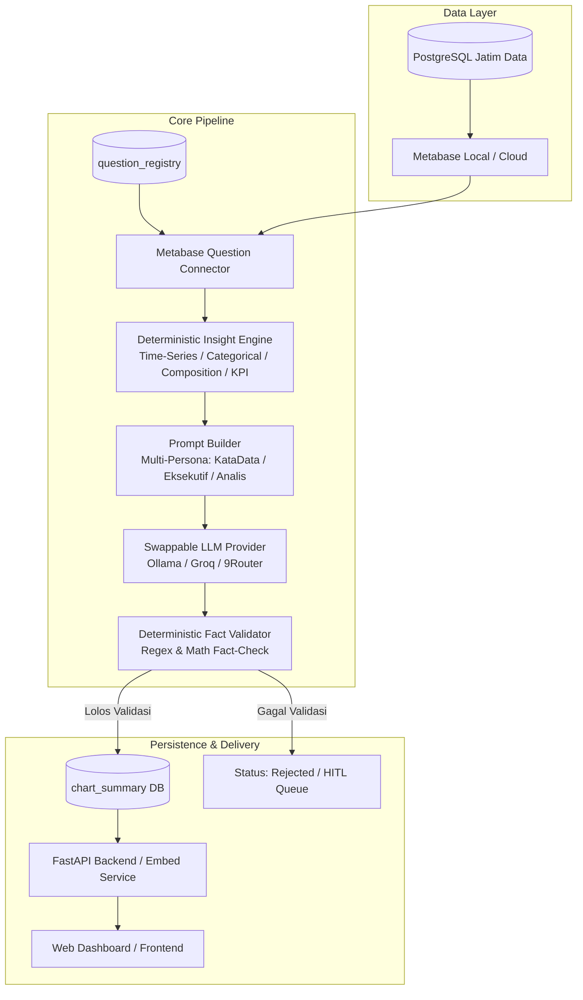

# Jawa Timur Public Strategic Dashboard & AI Narrative Summary (v2)

> **Platform Analitik Indikator Strategis Jawa Timur dengan Integrasi Metabase dan Generator Ringkasan Naratif Berbasis AI Multi-Persona yang Terverifikasi Secara Deterministik.**

[](https://www.python.org/)
[](https://fastapi.tiangolo.com/)
[](https://www.postgresql.org/)
[](https://www.metabase.com/)
[]()
[]()

---

## 📌 Ringkasan Proyek

Proyek ini bertujuan memecahkan masalah umum pada dashboard publik: *data grafik statistik sering kali sulit dipahami oleh masyarakat umum, media, maupun pimpinan daerah tanpa interpretasi naratif yang lugas*.

Sistem ini menghubungkan visualisasi data dari **Metabase** dengan generator ringkasan berbasis **LLM (Large Language Model)** menggunakan pendekatan **Deterministic Engine First**:
1. Angka dan tren dihitung secara matematis menggunakan **Insight Engine**.
2. Hasil kalkulasi diteruskan ke **LLM** untuk disusun menjadi narasi bergaya jurnalisme data (ala KataData) atau eksekutif.
3. Seluruh output narasi divalidasi oleh **Deterministic Fact Validator** sebelum disimpan ke database, memastikan **100% bebas halusinasi angka**.

---

## 🏗️ Arsitektur Sistem



---

## ✨ Fitur Utama (v2)

- 🔒 **Zero Hallucination Fact-Checking**: Validasi angka berbasis aturan deterministik menjamin tidak ada fakta palsu atau angka karangan pada narasi publik.
- 🔄 **Swappable LLM Providers**: Dapat dengan mudah beralih antara:
  - **Ollama** (Jalur A - Local Private LLM, e.g., Llama 3)
  - **Groq** (Jalur B1 - Ultra-Fast Cloud Inference API)
  - **9Router / OpenAI-Compatible** (Jalur B2 - Multi-model gateway)
- 📊 **Dynamic Question Registry**: Tidak ada lagi hardcode ID chart. Seluruh mapping visualisasi Metabase dikelola secara dinamis melalui tabel `question_registry`.
- 🐳 **Full Dockerized Environment**: Dilengkapi service container `metabase-local` dan PostgreSQL `metabase-db` dengan dataset contoh indikator strategis Jawa Timur (Inflasi, PAD, PDRB, Kemiskinan).
- 👥 **Multi-Persona Narrative Ready**: Skema basis data v2 mendukung persona audiens spesifik (Gaya KataData, Ringkasan Singkat Eksekutif, dan Analisis Lengkap).

---

## 🛠️ Tech Stack

| Komponen | Teknologi | Keterangan |
| :--- | :--- | :--- |
| **Backend Framework** | [FastAPI](https://fastapi.tiangolo.com/) | REST API, dynamic summary retrieval, signed JWT embed |
| **Language** | [Python 3.11+](https://www.python.org/) | Type-hinted, modular dataclasses, strategy pattern |
| **Database** | [PostgreSQL 16](https://www.postgresql.org/) | Storage untuk narasi ringkasan, registry, dan audit log |
| **BI & Visualisasi** | [Metabase](https://www.metabase.com/) | Visualisasi data publik & embedded analytics |
| **Orchestrator** | [Apache Airflow](https://airflow.apache.org/) | Batch summary pipeline scheduling |
| **LLM Inference** | Ollama / Groq / 9Router | Antarmuka standar `OpenAICompatibleProvider` |
| **Testing** | [pytest](https://docs.pytest.org/) | 140+ unit & integration test coverage |

---

## 🚀 Panduan Memulai Cepat (Quickstart)

### 1. Prasyarat Sistem
- Python 3.11 atau lebih baru
- Docker & Docker Compose
- Git

### 2. Clone Repository & Setup Environment

Pilih salah satu cara setup environment di bawah ini:

#### ⚡ Opsi A: Menggunakan `uv` (Direkomendasikan - Modern & Cepat)
Jika Anda menggunakan [uv](https://docs.astral.sh/uv/):
```bash
# Clone repository
git clone https://github.com/nafisfhkr/auto-chart-summary-dashboard.git
cd auto-chart-summary-dashboard

# Buat .venv & install semua dependencies dalam satu perintah:
uv sync

# (Opsional) Aktivasi venv jika ingin menjalankan perintah langsung:
# Windows (PowerShell): .\.venv\Scripts\Activate.ps1
# Linux / macOS:        source .venv/bin/activate
```

#### 🐍 Opsi B: Menggunakan Standar Python (`pip` bawaan)
Jika belum menginstal `uv`, Anda tetap dapat menggunakan tools bawaan Python:
```bash
# Clone repository
git clone https://github.com/nafisfhkr/auto-chart-summary-dashboard.git
cd auto-chart-summary-dashboard

# 1. Buat virtual environment
python -m venv .venv

# 2. Aktivasi virtual environment
# Windows (PowerShell):
.\.venv\Scripts\Activate.ps1
# Linux / macOS:
source .venv/bin/activate

# 3. Install dependencies
pip install -r requirements.txt
```


### 3. Konfigurasi Environment (`.env`)
Salin file template `.env.example` menjadi `.env`:
```bash
cp .env.example .env
```
Sesuaikan konfigurasi di file `.env`. Untuk memilih provider LLM, Anda cukup mengubah variabel `LLM_PROVIDER`:
```env
# Contoh menggunakan Ollama (Lokal):
LLM_PROVIDER=ollama
LLM_BASE_URL=http://localhost:11434/v1
LLM_MODEL=llama3:8b

# Atau contoh menggunakan Groq (Cloud API):
# LLM_PROVIDER=groq
# LLM_BASE_URL=https://api.groq.com/openai/v1
# LLM_API_KEY=gsk_your_groq_api_key_here
# LLM_MODEL=llama-3.1-70b-versatile
```

### 4. Menjalankan Container Docker (Metabase & Data Sample)
Pastikan Docker Engine / Docker Desktop sudah berjalan, lalu jalankan:
```bash
docker compose up -d metabase-db metabase-local
```
- **Metabase UI**: Akses melalui browser di [http://localhost:3000](http://localhost:3000)
- **Database Sample Jatim**: Berjalan di `localhost:5433` (User: `metabase`, Password: `metabase`, DB: `jatim_data`)

### 5. Inisialisasi Skema Database v2
Jalankan file migrasi SQL ke database PostgreSQL Anda secara berurutan:
```bash
# 1. Tabel utama v1
# 2. Idempotensi v1
# 3. Migrasi skema v2 (kolom multi-persona, benchmark, factual_payload)
# 4. Tabel question_registry
```
*(File SQL tersedia lengkap di direktori `sql/`)*.

### 6. Menjalankan Unit Tests
Pastikan semua modul berjalan dengan baik tanpa error:
```bash
pytest -v
```
Seluruh 140+ test case harus berstatus **passed**.

### 7. Menjalankan Server API Lokal
```bash
uvicorn app.api.main:app --reload --port 8000
```
Buka dokumentasi interaktif Swagger API di [http://localhost:8000/docs](http://localhost:8000/docs).

---

## 📁 Struktur Direktori

```text
auto-chart-summary-dashboard/
├── app/
│   ├── api/             # Endpoint FastAPI (dashboard, embed, summaries)
│   ├── config/          # Pengaturan settings.py dan metabase_charts.py
│   ├── core/            # Insight Engine & Deterministic Fact Validator
│   ├── prompts/         # Template prompt multi-persona (KataData, dll.)
│   ├── providers/       # Abstraksi LLM (Ollama, Groq, 9Router, Factory)
│   ├── repositories/    # Query database PostgreSQL & Metabase API
│   └── services/        # Orchestrasi pipeline end-to-end
├── dags/                # Airflow DAGs untuk automated scheduled summaries
├── docker/              # Dockerfile & init scripts untuk database & Airflow
├── docs/
│   ├── plan/            # Dokumen perencanaan sprint task-by-task
│   └── v2/              # Dokumen spesifikasi v2 (PRD, Arsitektur, UI/UX, Roadmap)
├── scripts/             # Script utilitas pengujian & eksekusi mandiri
├── sql/                 # Skrip DDL & migrasi database (001 s/d 005)
├── tests/               # Test suite pytest komprehensif
├── docker-compose.yml   # Orkestrasi container Metabase, Postgres, & Airflow
├── requirements.txt     # Daftar pustaka Python
└── README.md
```

---

## 🗺️ Roadmap Proyek (v2)

- [x] **Sprint 1 (Fondasi Data & Engine)**:
  - Dockerized Metabase lokal + dataset sample Jatim.
  - Migrasi skema database v2 (`chart_summary` & `question_registry`).
  - Abstraksi Swappable LLM Providers (Ollama & Groq).
- [ ] **Sprint 2 (Core Engine & Multi-Persona)**:
  - Auto-Classifier (routing tipe visualisasi Metabase ke insight engine).
  - Scalar/KPI Insight Engine.
  - Template prompt multi-persona (KataData, Eksekutif, Analis).
  - Payload sanitizer & penyimpanan JSONB `factual_payload`.
- [ ] **Sprint 3 (Frontend Web App)**:
  - Antarmuka portal publik dashboard interaktif.
  - Persona switcher & interactive evidence hover (fact-checking highlight).
- [ ] **Sprint 4 (HITL Moderation)**:
  - Analis review workspace & workflow approval (draft → approved → published).
- [ ] **Sprint 5 (Evaluation & Benchmark)**:
  - Benchmark runner pengujian performa, akurasi, dan efisiensi biaya model LLM.

Detail lengkap roadmap dapat dibaca di [docs/v2/roadmapsv2.md](file:///d:/Data%20Science%20Intern/Project/AIsummary-dashboard-jatim/docs/v2/roadmapsv2.md).

---

## 🤝 Berkontribusi

Ingin berkontribusi atau mengerjakan sprint bersama? Silakan baca panduan lengkap alur kerja git, konvensi kode, dan pengujian di **[CONTRIBUTING.md](file:///d:/Data%20Science%20Intern/Project/AIsummary-dashboard-jatim/CONTRIBUTING.md)**.

---

## 📄 Lisensi & Penggunaan Data

Repository ini menggunakan data sintetis dan data publik untuk tujuan riset, pengembangan, dan demonstrasi. Tidak ada data internal atau kredensial privat yang disimpan di dalam repository ini.